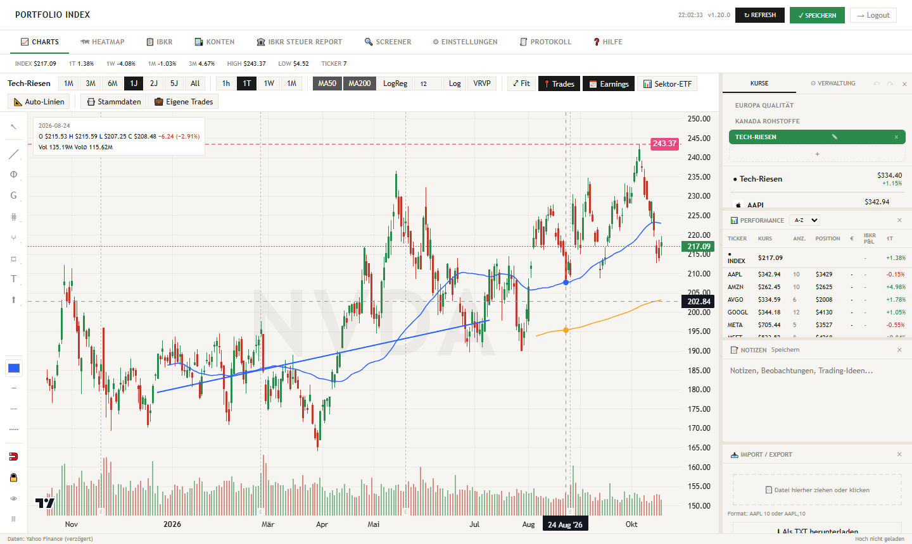
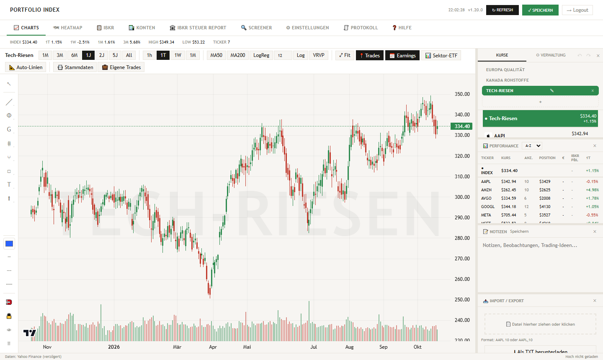
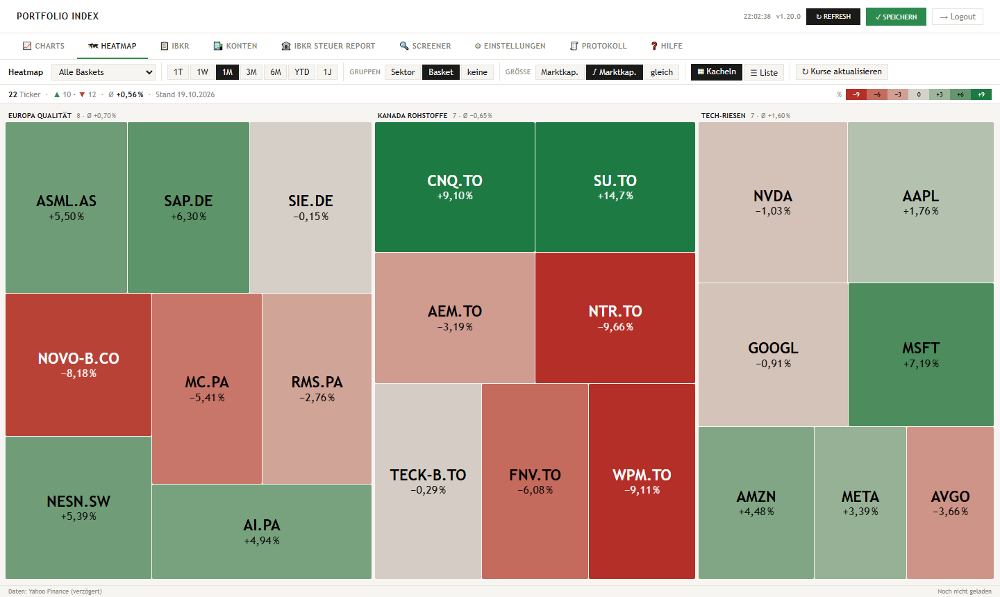
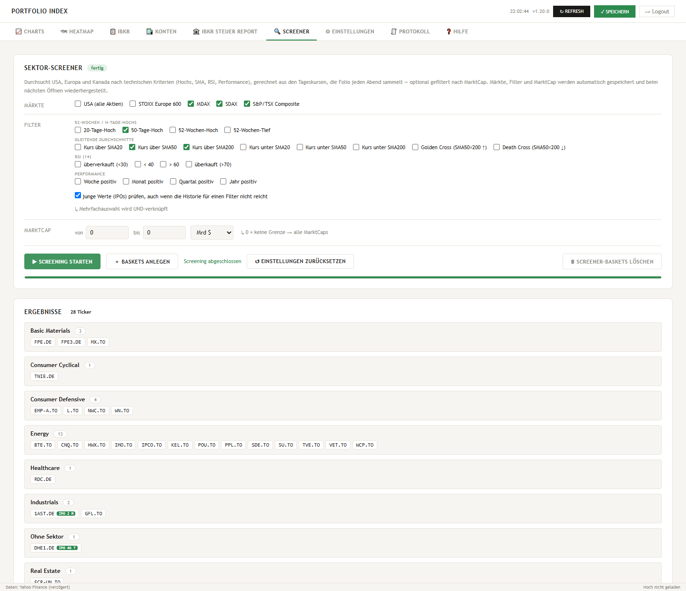

<h1 align="center">folio</h1>

<p align="center">
  <b>Persönlicher Aktienindex, Screener und Depot-Dashboard — selbst gehostet.</b><br>
  <i>Self-hosted portfolio &amp; market dashboard · German UI</i>
</p>

<p align="center">
  <a href="LICENSE"></a>
  
  
  
  
</p>

<p align="center">
  
</p>

> **In English:** build weighted stock baskets and chart them as your own index,
> screen ~6,800 stocks across the US, Europe and Canada with locally computed
> technical filters (new highs, moving averages, RSI, IPO-aware), and track an
> Interactive Brokers account, net worth and German capital-gains tax (Anlage KAP).
> FastAPI + vanilla JS, multi-user via OIDC, ready for Cloudron.

Ein persönlicher, gewichteter Aktienindex als Web-App. Du stellst Körbe
(„Baskets“) aus Tickern und Stückzahlen zusammen, folio rechnet daraus einen
Index und zeigt ihn als Chart — daneben jeden Einzelwert, dein Depot und dein
übriges Vermögen.

**Inhalt:** [Was folio kann](#was-folio-kann) · [Bilder](#bilder) ·
[Lokal starten](#lokal-starten) · [Auf Cloudron betreiben](#auf-cloudron-betreiben) ·
[Woher die Daten kommen](#woher-die-daten-kommen) · [Lizenz](#lizenz)

## Was folio kann

- **Baskets & Index** — beliebig viele Körbe, Stückzahlen (negativ = Short),
  Umrechnung fremder Währungen, Aktiensplits werden erkannt und zurückgerechnet.
- **Charts** — Stunden- (mit Vor- und Nachbörse), Tages-, Wochen- und
  Monatskerzen, gleitende Durchschnitte,
  log. Regression, Volumenprofil, Zeichenwerkzeuge (Linien, Fibonacci, Gann,
  Pitchforks, …), Earnings-Termine und für Einzelaktien der Vergleich mit dem
  Sektor-ETF.
- **Heatmap & Marktdaten** — Kacheln über die eigenen Baskets, einen ganzen
  Index (S&P 500, Nasdaq-100, Russell 2000) oder alle Aktien, die heute über
  dem Kurs stehen, zu dem man sie zuletzt verkauft hat. Dafür sammelt der Server
  je Handelstag Stunden- und Tageskurse aller Indexwerte, beim ersten Mal zwei
  Jahre zurück (Stand und Steuerung auf der Protokoll-Seite).
- **Interactive Brokers** — Positionen, Trades und Barbestand über die eigene
  Flex Query; Kauf und Verkauf erscheinen als Marker im Chart. Eine Übersicht
  zeigt verkaufte Aktien (auch Teilverkäufe), die heute über dem letzten
  Verkaufskurs stehen — split-bereinigt.
- **Konten & Vermögen** — Girokonten, weitere Depots (Bestand als CSV,
  Umsätze als CSV oder camt), Sachwerte und Darlehen, dazu eine Vermögenskurve.
- **Screener** — durchsucht den ganzen US-Markt (inklusive frischer IPOs), den
  STOXX Europe 600, MDAX, SDAX und den S&P/TSX Composite nach technischen
  Kriterien: neue Hochs und Tiefs, gleitende Durchschnitte, Golden/Death Cross,
  RSI, Performance, dazu ein Filter nach Marktkapitalisierung in US-Dollar.
  Gerechnet wird lokal aus selbst gesammelten Tageskursen, ein Lauf dauert
  Sekunden. Treffer landen je Sektor in festen Baskets, neue tragen am ersten Tag
  die Marke „neu“; was man aussortiert, sperrt eine Blacklist für eine
  einstellbare Zeit.
- **Steuer** — aus IBKR-Exporten eine Aufstellung für die Anlage KAP / KAP-INV
  samt PDF (siehe Hinweis unten).
- **Protokoll** — was die App gerade tut, in zehn Detailstufen; daneben der
  Verlauf, mit dem sich hinzugefügte und entfernte Ticker zurücknehmen lassen.

Die Oberfläche ist deutsch. Es gibt eine Desktop- und eine Mobilansicht; eine
ausführliche Hilfe steckt in der App selbst.

## Bilder

<table>
  <tr>
    <td width="50%"><br>
      <sub><b>Basket als Index</b> — gewichtet nach Stückzahl, daneben Kursliste und Performance</sub></td>
    <td width="50%"><br>
      <sub><b>Heatmap</b> — alle Baskets, nach Basket gruppiert, Veränderung über einen Monat</sub></td>
  </tr>
  <tr>
    <td width="50%"><br>
      <sub><b>Screener</b> — MDAX, SDAX und TSX nach neuem 50-Tage-Hoch über SMA50 und SMA200; junge Werte mit IPO-Marke</sub></td>
    <td width="50%"><br>
      <sub><b>Einzelwert</b> — MA50/MA200, Zeichenwerkzeuge, Plus/Minus der Kerze unter der Maus</sub></td>
  </tr>
</table>

<sub>Die Bilder zeigen Demo-Baskets; IBKR-, Konten- und Steuerseiten sind bewusst nicht abgebildet.</sub>

## Lokal starten

Voraussetzung ist Python 3.10 oder neuer.

```bash
python -m venv .venv
. .venv/bin/activate            # Windows: .venv\Scripts\activate
pip install -r requirements.txt
uvicorn main:app --port 8000
```

Dann <http://localhost:8000> öffnen. Ohne Anmeldedienst läuft folio mit einem
einzigen Benutzer; alle Daten liegen unter `./data` (anderer Ort über die
Umgebungsvariable `DATA_DIR`). Kurse holt folio beim **↻ Refresh** für alle
Ticker und beim Öffnen eines Einzelwerts für diesen einen.

Der Marktdaten-Sammler startet mit der App und arbeitet in zwei Runden:

- **Stundenrunde** (Mo–Fr nach US-Schluss): Stunden- und Tageskerzen der rund
  2.500 Werte aus S&P 500, Nasdaq-100 und Russell 2000, beim ersten Mal zwei
  Jahre zurück (gut eine Stunde, etwa 1 GB).
- **Tagesrunde** (Mo–Fr 22:30 Berliner Zeit): nur Tageskerzen der rund 6.800
  Screener-Werte aus USA, Europa und Kanada, dazu Marktkapitalisierung,
  Börsengang und Sektor. Die erste Runde dauert knapp zwei Stunden.

Wer das lokal nicht will: `FOLIO_MARKT=0` setzen — Index-Heatmap, 1h-Chart und
Screener bleiben dann leer bzw. holen nur einzeln angesehene Werte.

## Auf Cloudron betreiben

`Dockerfile` und `CloudronManifest.json` liegen bei. Das Manifest nutzt das
OIDC-Addon: Jeder Cloudron-Benutzer meldet sich mit seinem Konto an und
bekommt ein eigenes Datenverzeichnis unter `/app/data/<benutzer>/`.

```bash
docker build -t <registry>/folio:latest . && docker push <registry>/folio:latest
cloudron install --image <registry>/folio:latest
```

`.woodpecker.yml` ist die Pipeline, mit der das Original bei jedem Push auf
`main` baut und deployt — als Vorlage gedacht, sie braucht eigene Secrets
(`registry_user`, `registry_password`, `cloudron_token`) und eigene Hostnamen.

## Woher die Daten kommen

| Was | Quelle |
|---|---|
| Kurse, Stammdaten, Earnings, Tickersuche | Yahoo Finance (inoffizielle Schnittstelle, zeitverzögert) |
| Screener-Universum USA | Nasdaq-Symbolverzeichnis (alle US-Notierungen, täglich, per FTP) |
| Screener-Universum STOXX Europe 600, S&P/TSX Composite | Bestandslisten der iShares-ETFs (CSV) |
| Screener-Universum MDAX, SDAX | Instrumentenliste von Xetra (Deutsche Börse, CSV) |
| Indexlisten S&P 500, Nasdaq-100, Russell 2000 mit Sektor | Finviz |
| Depot, Trades | Interactive Brokers, Flex Query mit eigenem Token |
| Wechselkurse für die Steuer | Europäische Zentralbank |

Yahoo und Finviz sind keine offiziellen Datendienste; ihre Nutzungsbedingungen
gelten. folio fragt sparsam an: nur fehlende Tage, höchstens ein Abruf je
Ticker und Minute. Der Marktdaten-Sammler braucht je Handelstag rund einen bis
zwei Abrufe je Wert, mit Pausen dazwischen; Marktkapitalisierung und Börsengang
holt er gesammelt (150 Werte je Abruf). Drosselt Yahoo, bricht er ab und
versucht es eine Stunde später.

Der Screener braucht Finviz nicht mehr; der frühere Weg (Finviz je Index ×
Sektor, mit eigenen Finviz-Codes) steckt noch in `screener.py` und ist über
`POST /api/screener/run` mit `indexes` erreichbar, in der Oberfläche aber
ausgeblendet.

## Hinweis

folio ist ein privates Werkzeug, keine Anlage- und keine Steuerberatung. Die
Steuerseiten rechnen nach bestem Wissen, ohne Gewähr — vor der Abgabe prüfen.

## Lizenz

folio steht unter der **GNU Affero General Public License v3.0** (siehe
[`LICENSE`](LICENSE)). Wer folio verändert und anderen als Webdienst anbietet,
muss ihnen den geänderten Quellcode ebenfalls zugänglich machen.

Enthaltene Fremdbestandteile, jeweils mit eigener Lizenz:

- [`konvex_tax/`](konvex_tax/) — Steuer-Engine aus
  [KonvexInvestment/ibkr-steuer](https://github.com/KonvexInvestment/ibkr-steuer),
  MIT ([`konvex_tax/LICENSE`](konvex_tax/LICENSE))
- [`static/lib/lightweight-charts-drawing.umd.js`](static/lib/) — Zeichenwerkzeuge aus
  [deepentropy/lightweight-charts-drawing](https://github.com/deepentropy/lightweight-charts-drawing),
  MIT ([`static/lib/LICENSE.lightweight-charts-drawing`](static/lib/LICENSE.lightweight-charts-drawing)).
  Version 0.1.1, an einer Stelle angepasst: Die Beschriftungsfunktion schiebt Labels, die
  über den rechten Rand der Zeichenfläche ragen würden, nach links. Sonst verschwinden
  die Preise von H-Linie, H-Strahl, Kreuzlinie, Preisspanne und Fibonacci unter der
  Preisachse. Bei einem Update der Bibliothek muss diese Änderung neu eingebaut werden
  (`p=t.x*e` in der Funktion, die `roundRect` zeichnet).
- [TradingView Lightweight Charts](https://github.com/tradingview/lightweight-charts) —
  wird zur Laufzeit von unpkg geladen, Apache-2.0
